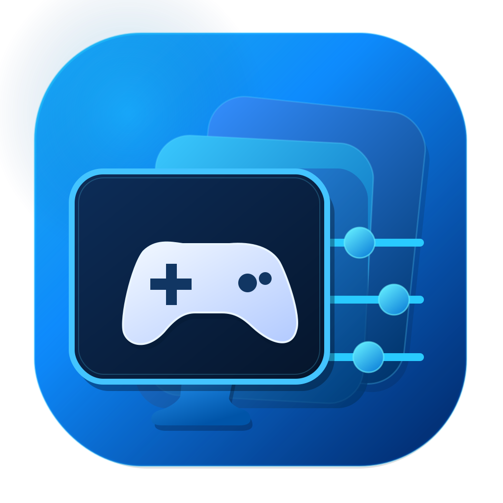

<p align="center">
  
</p>

<h1 align="center">Game Profile Manager</h1>

<p align="center">
  Manage per-game FPS limits, NVIDIA driver settings, and RTSS profiles on Windows 11.
  <br>
  <strong>A profile manager, not a game launcher.</strong>
</p>

<p align="center">
  <a href="README.md"><strong>English</strong></a> · <a href="README.ru.md">Русский</a>
</p>

<p align="center">
  <a href="https://github.com/Vladislav2505/GameProfileManager/releases">Download</a> ·
  <a href="https://github.com/Vladislav2505/GameProfileManager/issues">Report an issue</a> ·
  <a href="#build-from-source">Build from source</a>
</p>

<p align="center">
  <a href="https://github.com/Vladislav2505/GameProfileManager/actions/workflows/installer.yml"></a>
</p>

**Platform:** Windows 11 (x64) · **UI:** WinUI 3 / Windows App SDK · **Runtime:** .NET 10 · **Current application version:** 2.0.0

**Jump to:** [Features](#features) · [Install](#install) · [Quick start](#quick-start) · [Profiles & monitors](#profiles-and-monitors) · [Troubleshooting](#troubleshooting) · [Build](#build-from-source)

## Overview

Game Profile Manager applies game-specific settings to **RivaTuner Statistics Server (RTSS)** and **NVIDIA Driver Profile Settings (DRS)**. Set an FPS cap, choose a synchronization mode, and assign a profile to each game's executable. The app reads settings back after applying them and keeps the original values so you can restore them later.

Games continue to launch through Steam, Epic Games Launcher, shortcuts, or their own executables. Game Profile Manager does **not** launch games or track playtime.

## Features

- **Per-game profiles:** configure FPS limits, NVIDIA G-SYNC/fixed-refresh mode, V-Sync, and the RTSS limiter mode.
- **Monitor-aware assignments:** use one profile per game or assign different profiles based on the selected Windows display.
- **Automatic re-evaluation:** detect confirmed display configuration changes and apply the effective profile when needed; optionally check and reapply settings at startup.
- **Steam and Epic Games imports:** find installed games and select the correct `.exe` when discovery is ambiguous.
- **Verified application and recovery:** read settings back, store the original RTSS/NVIDIA values, and attempt rollback if an operation fails.
- **Windows 11 interface:** WinUI 3, system light/dark themes, Mica, adaptive navigation, and system controls.
- **Controller support:** SDL3 input for Xbox and PlayStation controllers, controller-friendly file selection, and an on-screen keyboard.
- **System tray and diagnostics:** keep display monitoring active in the tray, inspect integration status, and check for mismatched settings.

> [!NOTE]
> The **Graphics configurations** page is a preview of a planned feature. Saving, assigning, and applying snapshots of game configuration files are **not implemented yet**.

## Requirements

| Component | Requirement |
| --- | --- |
| Operating system | **Windows 11 x64** |
| Graphics driver | NVIDIA GPU with a compatible NVIDIA driver and NVIDIA DRS support |
| FPS limiter | **[RivaTuner Statistics Server (RTSS)](https://www.guru3d.com/download/rtss-rivatuner-statistics-server-download/)**, installed and running when applying profiles |
| Permissions | Administrator approval when starting the current version of Game Profile Manager |
| Runtime | Included in the installer (.NET 10, Windows App SDK, and SDL3) |

To use G-SYNC, enable it separately in NVIDIA Control Panel. The app configures the **per-game** driver profile; it does not enable global G-SYNC.

## Install

1. Download the latest installer from **[GitHub Releases](https://github.com/Vladislav2505/GameProfileManager/releases)**.
2. Install RTSS and make sure your NVIDIA driver is up to date. Start RTSS.
3. Run the installer, then launch **Game Profile Manager** and approve the Windows administrator prompt.
4. If RTSS is not detected, open **Settings** and select its installation directory.

The installer is self-contained; installing the .NET runtime or Windows App SDK separately is not necessary. It creates a Start menu shortcut and can optionally create a desktop shortcut.

**Upgrading from 1.x:** Version 2.0 uses WinUI 3 instead of WPF but retains the existing database and profile format. Exit the application completely (including the tray icon) before installing the update. Your data under `%LOCALAPPDATA%\GameProfileManager` is preserved.

## Quick start

1. Open **My games** and import games from Steam/Epic Games or add an `.exe` manually.
2. Check the selected executable. Some games have separate launchers and multiple executable files.
3. Open **Profiles**, select an existing preset or **create an editable copy**, and configure its settings. Built-in presets are protected from editing.
4. Open the game, assign the profile, and select **Apply profile to game**. Use **Apply to all** to process the library sequentially.
5. Check the reported result. You can use **Diagnostics** to inspect settings without changing them.

**Assigning** a profile stores a preference in the app. **Applying** it writes to RTSS and NVIDIA DRS. They are intentionally separate actions. Automatic application can also occur when enabled and a relevant display configuration change is detected or when startup checks require it.

### Application statuses

| Status | Meaning |
| --- | --- |
| **Applied** | RTSS and NVIDIA DRS values match the requested settings when read back. |
| **Pending** | The chosen settings have not been confirmed as applied. |
| **Restart required** | External settings were written, but a running game may need to restart. |
| **Unavailable** | A requirement is missing or the configuration cannot safely be resolved. |
| **Error** | An operation or verification failed; open the game details for the reason. |

## Profiles and monitors

A profile can use a **manual FPS limit (1–1000)** or a **fraction of the display refresh rate (1/1 through 1/12)**. Fractional mode is available only when a supported integer FPS limit can be determined. Windows dynamic refresh rate prevents fraction-based calculation.

If the selected profile's FPS cannot be calculated because the display is unavailable, uses dynamic refresh, or cannot produce an integer limit, **Apply leaves RTSS/NVIDIA settings and the captured backup unchanged**. Use **Restore original settings** explicitly to return to the saved values.

Other settings include the NVIDIA per-game refresh technology (G-SYNC allowed or fixed refresh), V-Sync, and an RTSS limiter mode. Game Profile Manager uses RTSS as its FPS limiter and sets the managed NVIDIA frame-rate limiter to disabled (`FRL_FPS = 0`) while applying a profile.

### Assignment modes

| Mode | Behavior |
| --- | --- |
| **One profile** | The same profile is used for the game. A fraction-based FPS limit can still depend on the selected display's refresh rate. |
| **By monitor** | Assign a profile to each display. If a display has no specific assignment, the game's default profile is used when available. |

When using **By monitor**, choose how the relevant display is determined:

| Display selection | Behavior |
| --- | --- |
| **Windows primary display** | Uses the display currently marked as primary in Windows. |
| **Selected display, otherwise default** | Uses the game's selected display; otherwise the app's default display, then the Windows primary display. |
| **Selected display only** | Requires the explicitly selected display; no automatic fallback when it is disconnected. |

The application checks the Windows display configuration periodically, including while minimized to the tray. **It does not detect which monitor a game's window is on**, and it does not change Windows resolution, refresh rate, or HDR settings.

## Safety, backups, and diagnostics

Before first modifying settings for a game's executable, Game Profile Manager saves the values that were already present in RTSS and NVIDIA DRS. If only part of an operation succeeds, it attempts to roll the changes back. Writes are followed by readback verification.

- **Check now / Diagnostics** reads external settings without fixing them.
- **Restore original settings** restores the captured values; after a successful restore, the app can also clear the game's assignments.
- **Export backup** in Settings creates a JSON copy of the application configuration.
- If an executable path changes and a backup exists for the old path, the app attempts to restore the old settings before accepting the new path.

**What verification means:** A successful readback proves that RTSS and NVIDIA DRS report the expected values. It does **not** measure actual in-game FPS or prove that VRR is active during gameplay.

> [!IMPORTANT]
> Game Profile Manager modifies game-specific external settings. Close running games before changing driver settings when possible, and keep a backup of your configuration. Restoring the originals may require RTSS to be running.

## Controller and system tray

SDL3 handles controller input, with Xbox-style labels or PlayStation button labels (including DualSense) as appropriate.

| Control | Action |
| --- | --- |
| D-pad / left stick | Move focus |
| A / ✕ | Select or activate |
| B / ○ | Go back or close a drop-down |
| Start / Options | Open or close the navigation pane; dialogs, file picker, and on-screen keyboard take priority |
| LB / RB · L1 / R1 | Switch top-level sections |
| Triggers / right stick | Scroll |
| On-screen keyboard | Enter text without a physical keyboard |

Use **Settings** to enable minimizing to the system tray and configure Windows startup. When the app is in the tray, display monitoring continues. Exit completely from the tray menu.

The interface follows Windows display scaling (Per-Monitor V2 DPI) and the system theme; Light and Dark overrides are available. The current build has a minimum window size of **960 × 560 effective pixels**.

## Updates and data

- **Updates:** Open **Settings → Backups and updates → Check for updates**. This performs an on-demand check of the latest GitHub Release. Download and install updates manually; the app does not automatically install them.
- **Database:** `%LOCALAPPDATA%\GameProfileManager\profiles.db` — SQLite storing one JSON state document, including assignments and captured settings.
- **Error log:** `%LOCALAPPDATA%\GameProfileManager\errors.log`.
- **Exported backups:** JSON files saved in the same application data directory.
- **Compatibility:** Version 2.0 preserves data from version 1.x. An unreadable database is not silently overwritten with a new empty state.

An optional **elevated launch without repeated UAC** feature uses a Windows Task Scheduler task. Configuring it requires an administrative launch and an installation under `Program Files` whose EXE path, owner, and ACL pass the protected-path check. The task accepts no caller-supplied arguments; autostart may still prompt for UAC. RTSS DLL loading likewise requires a protected `Program Files` installation. A user-writable RTSS folder is rejected before native loading, including when selected manually in Settings.

## Limitations

- **NVIDIA + RTSS only:** other GPU driver profile systems are not supported.
- **Not a game launcher:** no game launching, playtime tracking, or game-version management.
- **No display switching:** resolution, refresh rate, HDR, and Windows display topology are not changed.
- **No live VRR/FPS telemetry:** driver/RTSS setting readback is not an in-game performance measurement.
- **RTSS executable-name matching:** different games with the same `.exe` filename can cause ambiguous RTSS profiles; the app blocks unsafe writes.
- **Graphics configuration snapshots are not available yet.**

## Troubleshooting

**RTSS is not detected or is closed.** Confirm RTSS is installed and running, then select the RTSS directory in **Settings**. If the warning offers **Start RTSS**, use it and recheck the game; starting RTSS alone does not automatically apply the selected profile.

**A game stays Pending or Unavailable.** Confirm the game's actual `.exe`, the assigned profile, the display selection, and the RTSS/NVIDIA status in **Diagnostics**. An automatically calculated FPS limit may be unavailable for a dynamic or unsupported refresh rate.

**The game needs a restart.** Changes to NVIDIA driver settings may not affect a game that is already running. Close and reopen the game, then verify the saved settings.

**Two games use the same executable filename.** RTSS profiles are identified by filename. Choose distinct executable names where possible; the app intentionally prevents ambiguous writes.

For reproducible bugs, see [Issues](https://github.com/Vladislav2505/GameProfileManager/issues).

## Build from source

**Prerequisites:** Windows 11, [.NET SDK 10](https://dotnet.microsoft.com/download/dotnet/10.0), and optionally [Inno Setup](https://jrsoftware.org/isdl.php) to build the installer. Restore downloads the Windows App SDK NuGet dependencies automatically.

```powershell
# From the repository root
dotnet build .\GameProfileManager.slnx -c Release

# Unit / domain checks (no real RTSS/NVIDIA writes)
dotnet run --project .\tests\GameProfileManager.Tests -c Release

# Integration checks (read-only by default; may inspect local RTSS/NVIDIA)
dotnet run --project .\tests\GameProfileManager.IntegrationTests -c Release

# UI smoke tests, using fake external clients and temporary state
$smoke = Join-Path .\artifacts ("ui-smoke-" + [guid]::NewGuid().ToString("N"))
dotnet run --project .\tests\GameProfileManager.UITests -c Release -- $smoke
```

UI smoke tests require an interactive Windows desktop session. **Do not use** integration test flags `--write-test`, `--nvidia-write-test`, or `--sync-test` against live RTSS/NVIDIA unless you explicitly intend to modify settings.

Create a self-contained unpackaged build:

```powershell
dotnet publish .\src\GameProfileManager\GameProfileManager.csproj `
  -c Release -r win-x64 --self-contained true `
  -p:WindowsAppSDKSelfContained=true `
  -p:PublishSingleFile=false -p:PublishTrimmed=false `
  -o .\artifacts\test-exe
```

Run `GameProfileManager.exe` from the **entire published directory**; do not copy only the executable. `GameProfileManager.pri`, Windows App SDK libraries, and SDL3 are needed at runtime.

To build the installer (requires Inno Setup 6/7):

```powershell
.\scripts\build-installer.ps1
```

The installer is written to `artifacts\installer`. You can specify the compiler path with `-InnoCompiler`.

### Project structure

```text
GameProfileManager.slnx
src/
  GameProfileManager/          # WinUI 3 UI, input, tray, and source modules
    Core/                     # Domain models
    Application/              # Synchronization and profile resolution
    Infrastructure/           # SQLite persistence
    Integrations/             # NVIDIA, RTSS, Steam/Epic, displays
    Native/                   # SDL3 binary and its license
    Assets/                   # Application icon assets
  GameProfileManager.Engine/   # Engine project linking the modules above
tests/                       # Unit, integration, and WinUI smoke checks
installer/                   # Inno Setup configuration
scripts/                     # Installer build and performance measurements
.github/workflows/           # Windows installer CI
```

Core, application, infrastructure, and integration source files are linked into the separate `GameProfileManager.Engine` assembly by its project file.

### Releases

The [Windows installer workflow](.github/workflows/installer.yml) checks Release x64 compilation, isolated fake-client/SQLite tests, and WinUI resources on pull requests, `main`, and `v*` tags. The installer job runs only after these checks pass; UI smoke still requires a separate interactive Windows desktop. To publish a version, update `<Version>` in `src/GameProfileManager/GameProfileManager.csproj`, push the commit, then push a matching version tag (for example, `v2.0.0`). The workflow publishes the installer to GitHub Releases.

## Contributing and support

- Found a bug, unexpected setting change, or compatibility issue? [Open an issue](https://github.com/Vladislav2505/GameProfileManager/issues) with your Windows version, NVIDIA driver, RTSS version, reproduction steps, and relevant error details.
- For proposed changes, review [AGENTS.md](AGENTS.md) and keep existing database formats and safe readback/rollback behavior intact.
- Do not attach passwords, personal information, or unrelated system logs to issues.

## License

**No project-wide license is currently included in this repository.** Public access to source code does not automatically grant permission to redistribute or modify it. The bundled SDL3 binary has its own license in [`src/GameProfileManager/Native/SDL3-LICENSE.txt`](src/GameProfileManager/Native/SDL3-LICENSE.txt).
